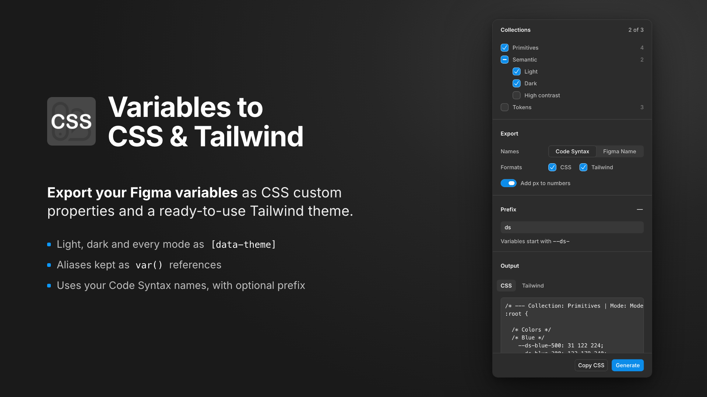

# Variables to CSS and Tailwind

Plugin de Figma que exporta las **variables locales** de un archivo como CSS custom properties y como un tema de `tailwind.config.js` que apunta a esas variables.



## Qué hace

- **CSS:** un bloque por colección y modo. Las colecciones con un solo modo van en `:root`. En las que tienen varios, el modo por defecto va en `:root, :root[data-theme="light"]` y el resto en `:root[data-theme="…"]`.
- **Tailwind:** `theme.extend` con `colors`, `spacing`, `borderRadius`, `borderWidth`, `fontSize`, `lineHeight`, `letterSpacing`, `fontWeight` y `fontFamily`, siempre apuntando a la variable CSS (`rgb(var(--text-primary) / <alpha-value>)`), así el cambio de tema también funciona en Tailwind.
- **Alias:** se mantienen como `var(--…)`. Si la variable de origen no se exporta (por ejemplo, viene de una librería), se escribe su valor con un comentario `/* alias: … */`.
- **Nombres:** usa el *Code Syntax (Web)* de cada variable o su nombre en Figma, con prefijo opcional.
- **Valores:** los colores se escriben como canales RGB (`31 122 224`, o `0 0 0 / 0.5` si tienen transparencia). Pesos de fuente, opacidad y line-heights multiplicadores van sin unidad; el resto de números, en `px` (opcional).

### Ejemplo

```css
/* --- Collection: Primitives | Mode: Mode 1 --- */
:root {
  --blue-500: 31 122 224;
  --overlay: 0 0 0 / 0.5;
}

/* --- Collection: Semantic | Mode: Light --- */
:root, :root[data-theme="light"] {
  --text-primary: var(--blue-500);
}

/* --- Collection: Semantic | Mode: Dark --- */
:root[data-theme="dark"] {
  --text-primary: var(--blue-300);
}
```

```js
// tailwind.config.js
module.exports = {
  theme: {
    extend: {
      colors: {
        "text": {
          "primary": "rgb(var(--text-primary) / <alpha-value>)"
        }
      }
    }
  }
};
```

En CSS, usa los colores con `rgb()`: `color: rgb(var(--text-primary));`.

## Estructura

| Ruta | Contenido |
|---|---|
| `code.ts` | Lógica del plugin (se compila a `code.js`) |
| `ui/` | Interfaz UI3 con [FigUI3](https://www.npmjs.com/package/@rogieking/figui3): `index.html`, `main.js`, `styles.css` |
| `dist/ui.html` | Interfaz compilada en un solo HTML (Vite + `vite-plugin-singlefile`) |
| `tests/` | Pruebas de la lógica con un API de Figma simulado |
| `assets/` | Ícono (128×128) y portada (1920×1080) para Figma Community |
| `docs/PUBLISHING.md` | Checklist y textos para publicar |
| `THIRD_PARTY_NOTICES.md` | Licencias de terceros incluidas en la UI |

`code.js` y `dist/` no se versionan: se generan con `npm run build`.

## Desarrollo

Requiere Node.js 20.19+ o 22.12+ (lo exige Vite 8).

```bash
npm ci
npm run build      # code.js + dist/ui.html (por separado: build:code / build:ui)
npm test           # pruebas de la lógica
npm run lint
```

Para probarlo en Figma: **Plugins → Development → Import plugin from manifest…** y elige `manifest.json`.

### Contrato de mensajes UI ↔ plugin

| Dirección | Mensaje | Payload |
|---|---|---|
| UI → plugin | `INIT` | — |
| UI → plugin | `RUN` | `{ collectionIds, nameMode, format, unitPxForFloat, prefix, modesByCollection }` |
| plugin → UI | `INIT_DATA` | `[{ id, name, modes: [{ modeId, name }], variableCount }]` |
| plugin → UI | `RESULT` | `{ css, tailwind }` |
| plugin → UI | `ERROR` | `{ request: "INIT" \| "RUN", message }` |

El plugin siempre responde a `INIT` y `RUN` (con el resultado o con `ERROR`), para que la UI nunca quede cargando.

## Publicar

Ver [docs/PUBLISHING.md](docs/PUBLISHING.md).
